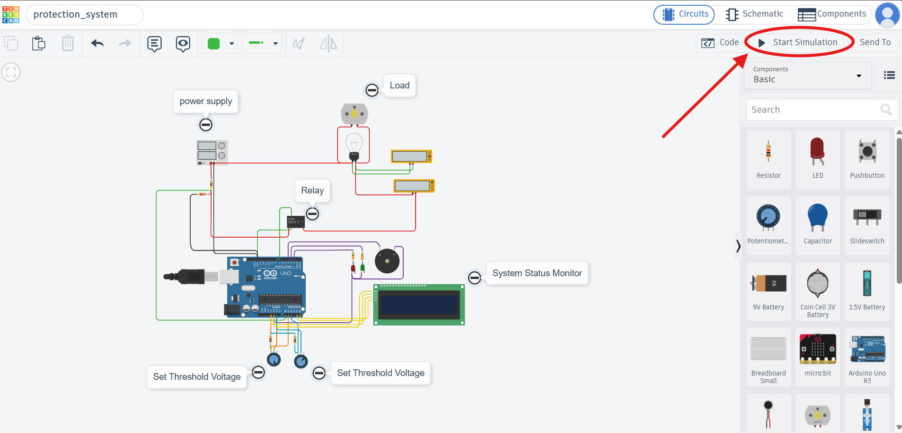
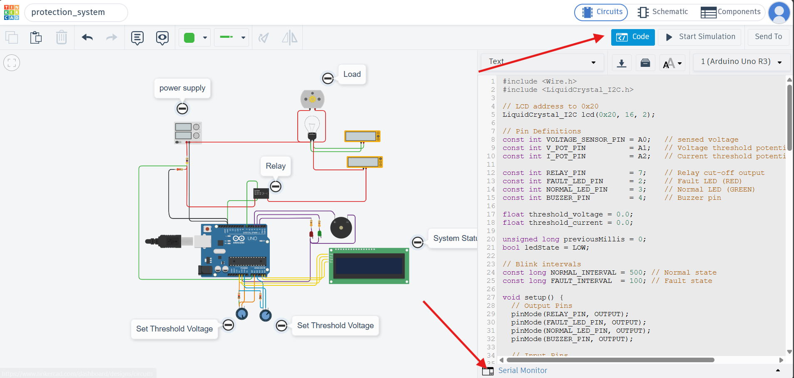

You can simulate the program by clicking the **“Start Simulation”** button at the top.

To view the firmware, click the **“Code”** button. The **Serial Monitor** can be found at the bottom of the window.

